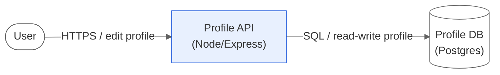
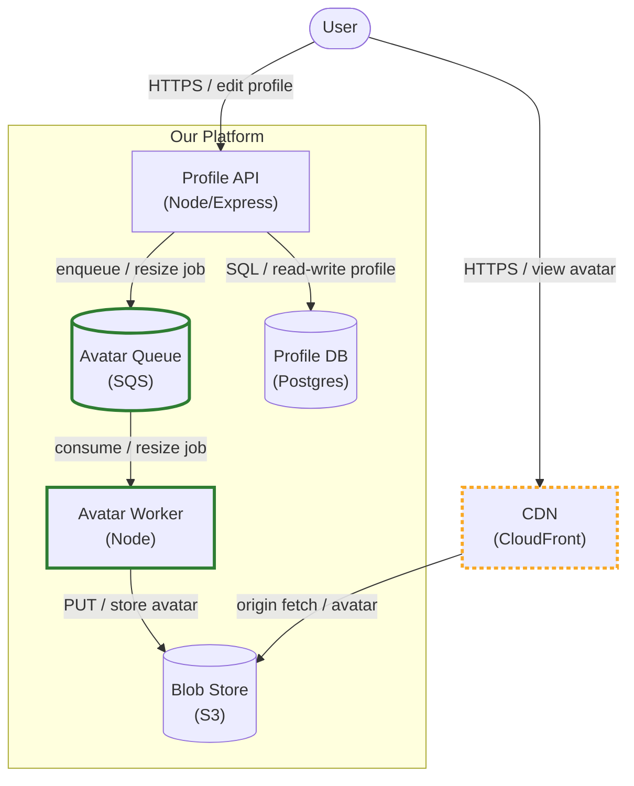
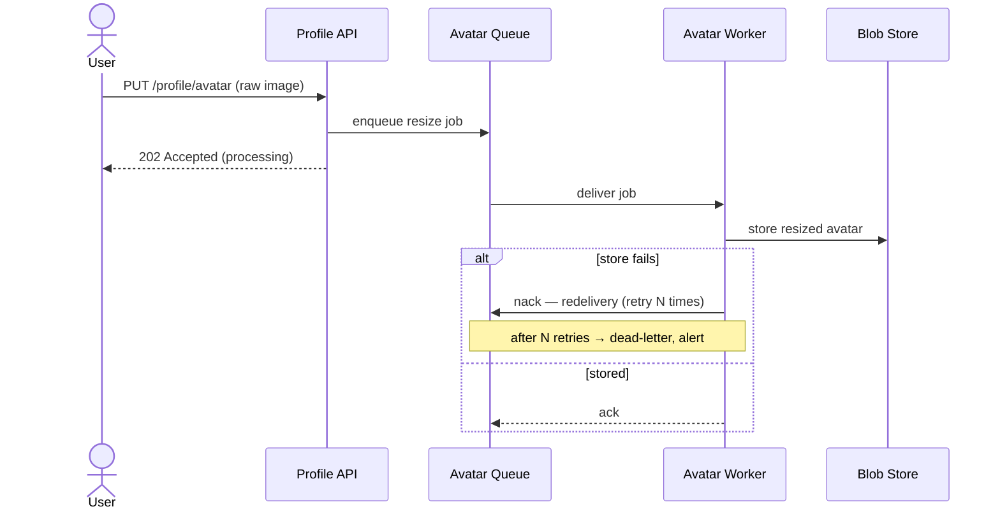
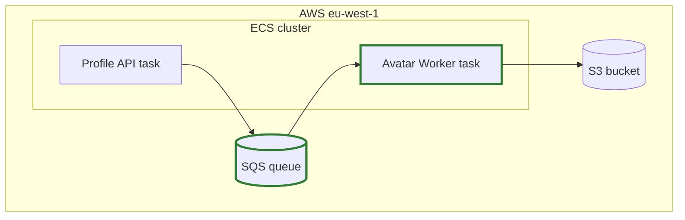

# Diagram Conventions

Copy-ready mermaid patterns for the architecture delta's pieces, and the taste every diagram
follows. Two rules run through all of them:
**C4-as-method, flowchart-as-carrier** (mermaid's dedicated C4 syntax is experimental — use standard
`flowchart` / `sequenceDiagram` and apply C4 discipline by hand), and **the delta is visible**
(new/modified/removed read differently from unchanged at a glance).

---

## Taste — every diagram

Every diagram follows this taste: a delta's pieces, the spine's container view and key flows, and
each file of the store's diagram set. It is drawn from an editorial diagram practice as far as
Mermaid carries it; Mermaid lays a diagram out itself, so that practice's SVG-only rules — a 4px
grid, shadows, exact geometry — do not carry.

- **Delete first, then the paragraph test.** Before drawing, cut every node and edge the point does
  not need, then ask: would a reader learn more from this than from a well-written paragraph? If
  not, write the paragraph and draw nothing.
- **About 12 nodes.** The node budget is the delta neighborhood's threshold (*Scale bound in
  practice*, below); a picture that needs more is two diagrams, or one that links the wider map.
- **A title and a caption.** Every diagram has a title above its block — its heading, in a diagram
  file the one `##` heading — and one line under the block saying what the reader should see.
- **One accent color.** An `accent` class marks the one or two things the reader should look at
  first, and nothing else. A delta keeps its three classes — new · modified · removed — beside it;
  the accent is never a fourth status.
- **Hairline strokes, no fills beyond the accent.** Plain nodes and edges keep thin strokes, and a
  plain node's ground is white (`primaryColor` below), which reads as no fill; the delta classes
  keep their marked strokes, since a delta is meant to be seen.
- **One font family,** set by the init directive.
- **A delta reads Before · Changes · After** through its classes: the plain and struck nodes are
  what was there, the new and modified ones what changes, and the drawing without the struck nodes
  what will be.

**Profile edit path**

An edit lands at the Profile API first — the one accented node.

**The init directive holds only where the renderer honors it.** A renderer that ignores it draws
its own theme and font, so no diagram depends on it: the accent and the delta classes carry the
meaning.

**One home.** This section is the one home of diagram taste; the trust-boundary diagram convention
queued in the security-depth build (`BACKLOG.md`, *Security-depth build*) extends it here.

---

## Container delta diagram

The sign-off surface: the target state at C4 **container** level, with the delta marked. Boundaries
are `subgraph` blocks, technology lives in the node label, and every arrow carries **protocol +
purpose**.

**Delta styling — the convention:**

| Status | Style | mermaid |
|--------|-------|---------|
| **new** | solid, thick, green stroke | `classDef new stroke:#2e7d32,stroke-width:3px;` + `:::new` on the node |
| **modified** | thick, amber, dashed stroke | `classDef modified stroke:#f9a825,stroke-width:3px,stroke-dasharray:4 3;` + `:::modified` |
| **removed** | struck / greyed, kept for one delta so the reader sees what left | label prefix `~~removed~~` (or `classDef removed stroke:#9e9e9e,color:#9e9e9e;`) |
| **existing** | default (no class) | plain node |

Node-shape hints (optional, aids reading): `["service"]` process, `[("store / queue")]` datastore or
queue, `(["actor"])` person/external actor, `{{"external system"}}` third-party. Don't over-encode —
the label + technology + delta styling carry the meaning; shapes are a light aid.

**Rendering:** the diagram is Mermaid text that must parse — the text is what the user signs, and it
renders wherever it is viewed (GitHub, an IDE preview); where the session can render it, the picture
is shown beside the text. Keep node ids short and label text in quotes so protocol slashes and
` ` render cleanly.

---

## Sequence diagram — one per qualifying flow

A **qualifying flow** crosses ≥2 components and has non-trivial ordering or failure semantics (a user
journey *or* a system flow). Show the ordering *and* the failure path — the failure path is usually
why the flow qualifies.

Use `alt` / `opt` / `Note` to make ordering and failure explicit. Participants are the same
components named in the container diagram (and, for a changed element, the checkpoint table) — keep
the names identical across all three pieces.

---

## Deployment view — conditional

Author **only when the change carries `IP-XXX` provisioning rows** (it changes deployment reality).
A flowchart with runtime/infra boundaries as subgraphs:

No `IP-XXX` rows → omit the section and record the omission in one line
(`no deployment change — no IP-XXX rows`).

---

## Scale bound in practice

When the delta neighborhood (changed components + direct collaborators) exceeds the box threshold
(**default ~12 rendered nodes**, overridable per project), do not inline the full system. Inline the
neighborhood; add one line linking the wider map — the store's topology spine — for everything
unchanged. On a large system the spine is the estate; the delta is only ever the neighborhood the
change touches.
